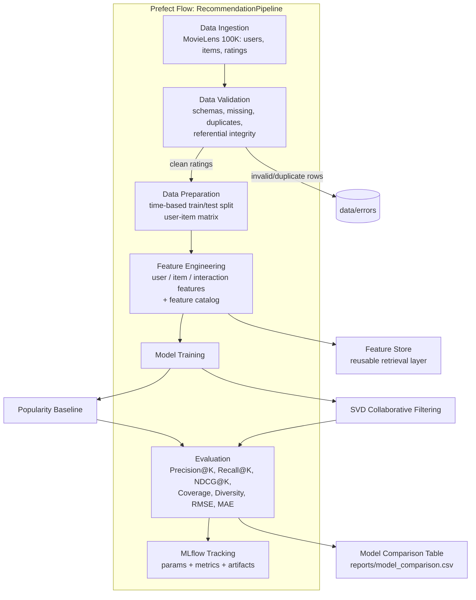
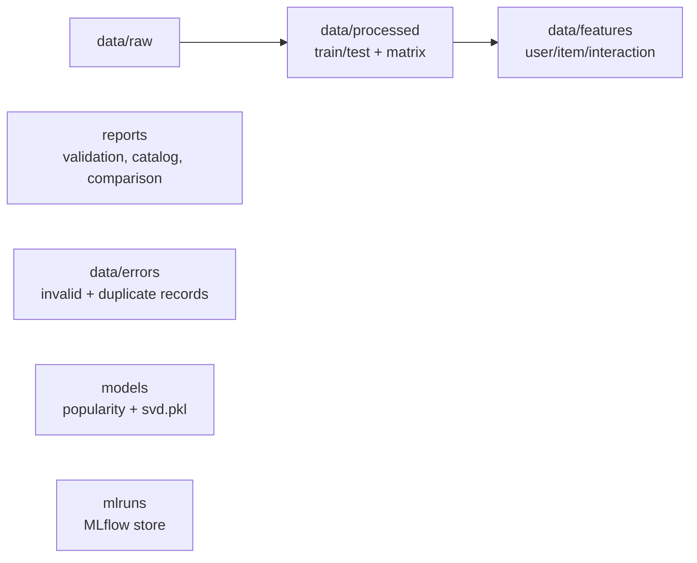

# Pipeline Architecture

## High-Level Flow

## Storage Layout

## Components

| Layer | Module | Responsibility |
|-------|--------|----------------|
| Config | `src/utils.py` + `config/config.yaml` | Central config + path helpers |
| Ingestion | `src/download_dataset.py`, `src/ingestion.py` | Download + load users/items/ratings (incl. genres) |
| Validation | `src/validation.py` | Schema + integrity checks; separate error records; return clean data |
| Preparation | `src/preparation.py` | Time-based split, user-item matrix |
| Features | `src/feature_engineering.py`, `src/feature_store.py` | Feature creation, catalog, retrieval layer |
| Models | `src/popularity_model.py`, `src/collaborative_model.py` | Baseline + SVD |
| Evaluation | `src/evaluation.py` | Ranking + rating metrics, comparison table |
| Tracking | `src/mlflow_tracking.py` | MLflow params/metrics/artifacts |
| Orchestration | `orchestration/prefect_pipeline.py` | Prefect flow wiring all stages |

