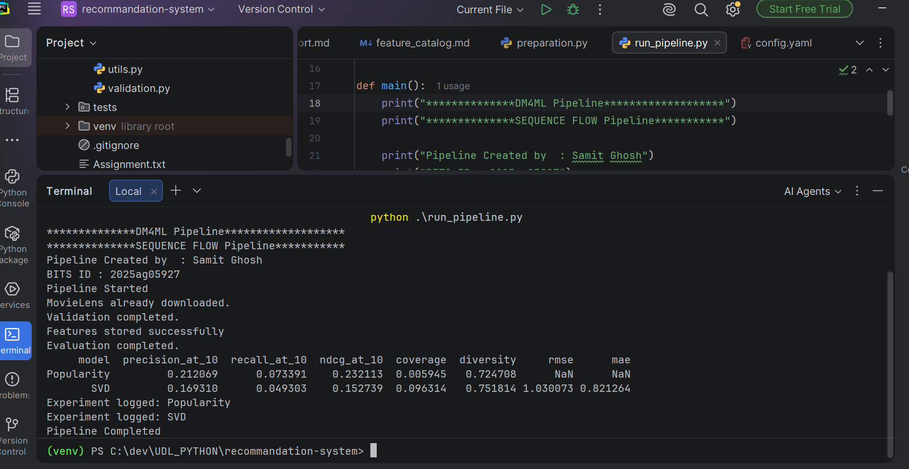
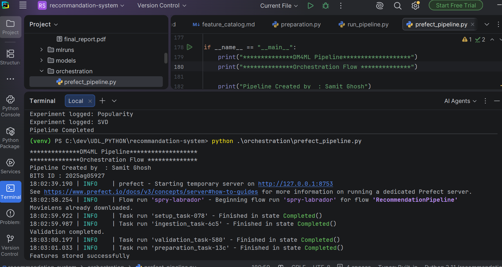
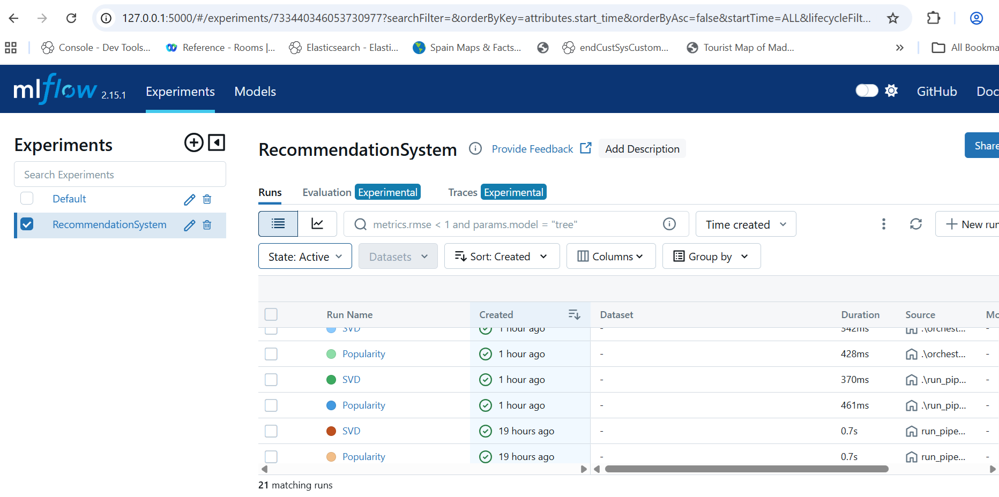
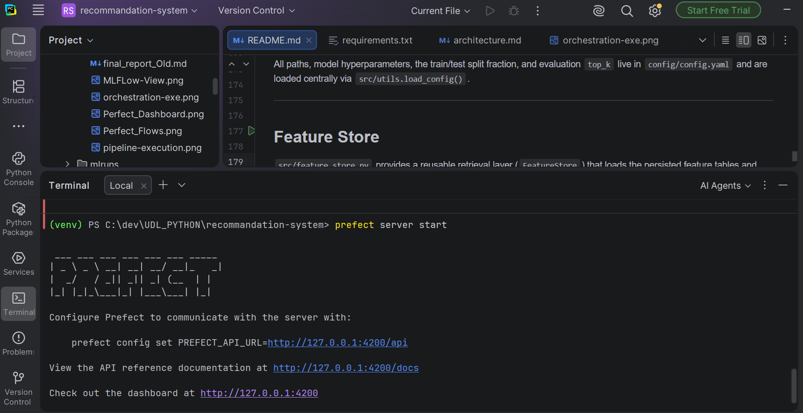
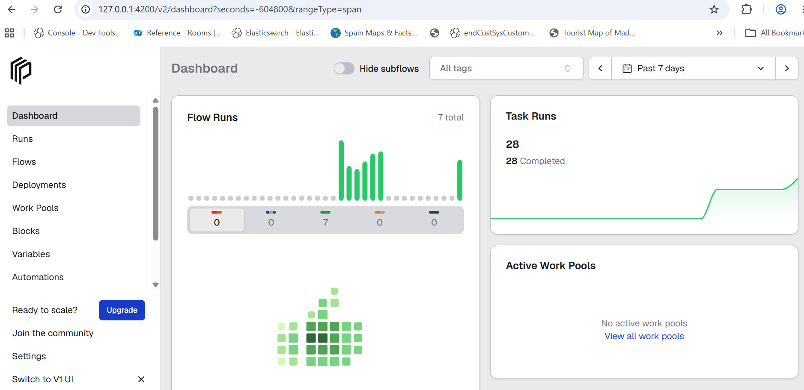
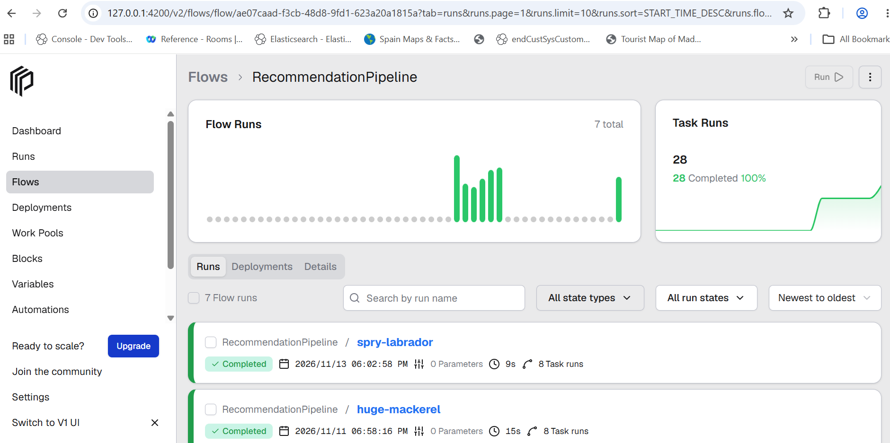

# Final Report: End-to-End Recommendation Pipeline

## Executive Summary

This project delivers an **end-to-end data management pipeline for a recommendation system**, built
on the public **MovieLens 100K** dataset (a movie platform use case). The pipeline recommends
relevant movies to users based on their past rating interactions and item information, and covers
every required stage in sequence: **Data Ingestion → Data Validation → Data Preparation &
Transformation → Feature Management → Model Training → Model Evaluation → Orchestration**.

The solution ingests users, items (including genres), and rating interactions; runs automated
quality checks (missing values, duplicates, data types, invalid ratings, invalid timestamps, and
referential integrity) with invalid records separated into an error dataset; cleans and standardizes
the data; and produces a **time-based** train/test split along with derived datasets (user activity
summaries, item popularity, and a user-item interaction matrix). Reusable user, item, and
interaction features are generated, documented in a **feature catalog**, and served through a
`FeatureStore` layer for both training and prediction.

Two models are trained and compared: a **popularity baseline** and a personalized **SVD
matrix-factorization** recommender. Models are evaluated with **Precision@10, Recall@10, NDCG@10,
Coverage, and Diversity**, plus **RMSE and MAE** for SVD's explicit-rating predictions, with all
parameters, metrics, and artifacts tracked in **MLflow**. The complete workflow is automated and
made reproducible as a **Prefect** flow with correct task dependencies, and can be executed
end-to-end from the README. On MovieLens, the popularity baseline achieves higher top-K hit rates
while SVD provides far broader catalog **coverage** and higher **diversity** — the classic
accuracy-vs-coverage trade-off. The emphasis throughout is on a **clean, modular, reproducible**
pipeline rather than raw model accuracy.

## 1. Overview

This project implements a complete, reproducible data-management pipeline for a movie
recommendation system using the **MovieLens 100K** dataset. The pipeline covers the full lifecycle:
ingestion, validation, preparation/transformation, feature management, model training, evaluation,
and orchestration, with experiment tracking in MLflow.

Two entry points are provided:
- `run_pipeline.py` — a sequential run.
- `orchestration/prefect_pipeline.py` — the same stages wired as a **Prefect** flow with explicit
  task dependencies.

## 2. Design Decisions

**Dataset.** MovieLens 100K is a well-understood public dataset with explicit 1–5 ratings, user
demographics, and item genres — ideal for demonstrating collaborative filtering and content signals.

**Configuration-first.** All paths, hyperparameters, the split fraction, and evaluation `top_k`
live in `config/config.yaml` and are loaded via `src/utils.load_config()`. Modules resolve paths
relative to the project root, so the pipeline runs from any working directory.

**Validation returns clean data.** The validator checks user/item/rating schemas, missing values,
duplicates, and referential integrity. Invalid and duplicate records are written to `data/errors/`
and **removed** from the data passed downstream, so models only train on valid rows.

**Time-based split.** To avoid look-ahead leakage, the train/test split is chronological: the most
recent 20% of interactions (by timestamp) form the test set. Features are computed from the
**training split only**.

**Feature management.** User, item, and interaction features are generated and persisted as Parquet.
A `FeatureStore` retrieval layer serves features by `user_id`/`movie_id` for both training and
inference. A machine-readable **feature catalog** is generated at `reports/feature_catalog.md/.csv`.

**Two models.** A **popularity baseline** (global most-rated items) and a personalized **SVD**
matrix-factorization model (`scikit-surprise`). SVD filters already-seen items from its
recommendations.

**Experiment tracking.** Each model run logs its parameters, evaluation metrics, and the serialized
model artifact to MLflow (`mlruns/`).

## 3. Tools Used

| Concern | Tool |
|---------|------|
| Data manipulation | pandas, numpy |
| Validation | Pandera |
| Modeling | scikit-surprise (SVD), scikit-learn |
| Experiment tracking | MLflow |
| Orchestration | Prefect 3 |
| Storage | Parquet (pyarrow), CSV |

## 4. Results

Evaluation at **K = 10** on the chronological test set (see `reports/model_comparison.csv`):

| Model | Precision@10 | Recall@10 | NDCG@10 | Coverage | Diversity | RMSE | MAE |
|-------|-------------|-----------|---------|----------|-----------|------|-----|
| Popularity | 0.212 | 0.073 | 0.232 | 0.006 | 0.725 | – | – |
| SVD | 0.169 | 0.049 | 0.153 | 0.096 | 0.752 | 1.030 | 0.821 |

**Interpretation.**
- The **popularity baseline** scores higher on top-K ranking metrics. This is expected on MovieLens:
  popular blockbusters are rated by most users, so a global top-10 list overlaps strongly with each
  user's held-out high-rated items.
- **SVD** provides much higher **coverage** (~16x) and slightly higher **diversity**, meaning it
  recommends a far broader catalog and more varied genres rather than the same few blockbusters.
- Only **SVD** predicts explicit ratings, achieving **RMSE 1.03 / MAE 0.82**.
- The trade-off is classic accuracy-vs-coverage: popularity wins raw hit-rate; SVD personalizes and
  diversifies.

## 5. Limitations and Future Work

- **Top-K ranking from SVD** is computed by scoring all candidate items per user, which is
  acceptable at 100K scale but would need approximate nearest-neighbor retrieval at larger scale.
- **Cold-start:** SVD cannot score unseen users/items; a content-based or hybrid fallback using the
  available genre features would help.
- **No hyperparameter search** — SVD uses fixed, config-driven parameters.
- **Relevance threshold** for ranking metrics is fixed at rating >= 4; sensitivity analysis would be
  valuable.
- **Diversity** is measured on genre vectors of recommended items; richer item embeddings would give
  a finer-grained signal.
- A content-based model (using the preserved genre features) was scoped but not trained; it is the
  natural next addition to form a hybrid recommender.

## 6. Reproducibility

- Pinned `requirements.txt` with wheel-available versions (no compiler needed).
- Deterministic SVD (`random_state`) and a deterministic time-based split.
- One-command execution via `run_pipeline.py` or the Prefect flow; all artifacts are regenerated.

## 7. Requirements Verification

| SL | Requirement | Status | Evidence |
|----|-------------|--------|----------|
| 1 | Data Ingestion | ✅ | `ingestion.py` — users, items (+genres), ratings from MovieLens |
| 2 | Data Validation | ✅ | missing, duplicates, data types, invalid ratings, invalid timestamps (now bounded), referential integrity; errors separated to `data/errors/` |
| 3 | Preparation & Transformation | ✅ | clean/dedupe, time-based split, user/item summaries, user-item matrix |
| 4 | Feature Management | ✅ | user/item/interaction features incl. `preferred_category`, days-since-last; `FeatureStore` reusable layer; catalog table |
| 5 | Model Training (2) | ✅ | Popularity + SVD; MLflow params/metrics/artifacts |
| 6 | Model Evaluation | ✅ | Precision@10, Recall@10, NDCG@10, Coverage, Diversity, RMSE, MAE; comparison table |
| 7 | Orchestration | ✅ | Prefect flow, 8 tasks, reproducible, correct deps |

## 8. Deliverables

| Deliverable | Status |
|-------------|--------|
| Modular source code | ✅ |
| README (setup + execution) | ✅ |
| requirements.txt | ✅ |
| Architecture diagram | ✅ |
| Validation report/logs | ✅ |
| Feature catalog (table) | ✅ |
| Model evaluation results | ✅ |
| Orchestration workflow file | ✅ |
| Final report (2–3 pages) | ✅ (`docs/final_report.md`, `final_report.pdf`) |
| Repo Link | ✅ https://github.com/samitbits/recommandation-system/ |

## 9. Appendix

### Pipeline Execution Reference

**1. Pipeline execution**

**2. Orchestration execution**

**3. MLflow UI**

**4. Prefect Server Start**

**5. Prefect Dashboard UI**

**6. Prefect Flows UI**

